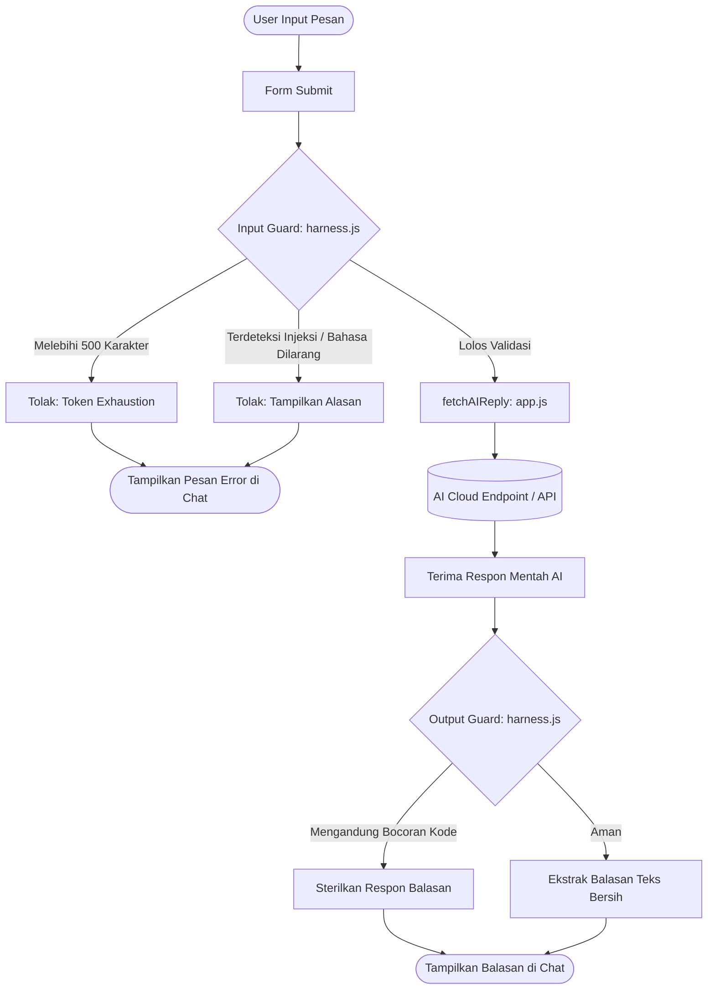

# AI Chat Automation Prototype

Prototipe web chat AI sederhana, modular, dan dilengkapi sistem perlindungan keamanan (AI Harness / Guardrails).

## Fitur Utama
1. **Antarmuka Chat Minimalis**: Tampilan chat box bersih tanpa dependensi framework (Vanilla HTML, CSS, JS murni).
2. **Sistem Harness Terpisah (`src/js/harness.js`)**:
   - **Input Guard**: Validasi input sebelum dikirim ke API (menghemat token).
   - **Normalisasi Teks**: Deteksi bypass berbasis spasi (`c.s.s`), teks terbalik (*reverse prompt*), dan decoding Base64.
   - **Perlindungan Injeksi**: Menangkal SQL Injection, Prompt Injection (Jailbreak/DAN), System Prompt Leak, dan serangan XSS.
   - **Pembatasan Karakter**: Mencegah Token Exhaustion (Denial of Wallet) dengan batas maksimal 500 karakter/pesan.
   - **Output Guard**: Menyaring balasan model AI sebelum ditampilkan ke layar untuk memastikan tidak ada kode terlarang yang bocor.
3. **Konfigurasi Fleksibel**: Parameter model, endpoint, dan API key terisolasi di file konfigurasi.

---

## Alur Kerja Sistem (Flowchart)



---

## Struktur File & Folder
```text
├── index.html          # Halaman utama tampilan chat
├── config.example.js   # Contoh konfigurasi API
├── config.js           # Konfigurasi aktif (diabaikan git)
├── README.md           # Dokumentasi & panduan proyek
└── src/
    ├── css/
    │   └── style.css   # Styling antarmuka chat
    └── js/
        ├── harness.js  # Guardrails, normalisasi teks & proteksi keamanan
        └── app.js      # Logika interaksi chat & komunikasi AI
```

---

## Cara Menjalankan
1. Salin `config.example.js` menjadi `config.js`:
   - Masukkan **API Key AI Anda**.
   - Sesuaikan **AI Endpoint** dan **Model** sesuai penyedia layanan yang digunakan.
2. Buka `index.html` langsung di browser web Anda.
